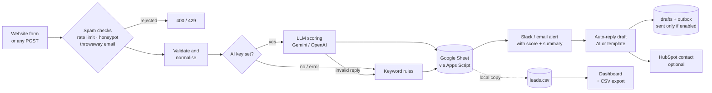
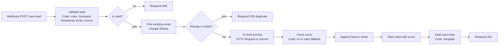

# Lead Form → AI Scoring → Google Sheets → Slack/Email Alert

**Every website enquiry is checked for spam, scored hot / warm / cold by AI, saved to a Google Sheet and sent to your team within seconds - with a personalised reply to the lead drafted and waiting for review.**

> **Live demo:** https://ai-lead-scoring-iopj.onrender.com/ — send a test enquiry, then open [/dashboard](https://ai-lead-scoring-iopj.onrender.com/dashboard) to see it scored *(free hosting: the first open after a quiet spell takes up to a minute while the server wakes up; fictional sample data, offline mode, no API keys)*


*Screenshot: the leads dashboard in offline demo mode with seven fictional leads (all names and addresses are made up, `example.*` domains). Scores here come from the built-in keyword rules; with an API key the AI writes them.*

Two implementations of the same flow are included:

1. **Python app** (`app/`) - a small web server with the form, spam checks, AI scoring, sheet connector, alerts, auto-reply drafts and a dashboard. Only one dependency (`requests`).
2. **n8n workflow** (`n8n/`) - the same flow with an AI scoring step, for clients who prefer a no-code tool they can edit themselves.

## Architecture



## Features

| | Typical "form to sheet" setup | This project |
|---|---|---|
| Storage | Row appended | Row appended, de-duplicated by email under a lock, formula-injection guard, retries with backoff |
| Lead quality | Every lead looks the same | **Hot / warm / cold score**, intent, urgency, budget (only if the lead wrote one) and a one-line summary |
| AI failure | Workflow errors out | Any AI error or invalid reply falls back to transparent keyword rules; the lead is never lost |
| Alert | "New form submission" | `[HOT] New lead: Priya (Tree surgery) via google` + score line + summary |
| Reply to the lead | Generic autoresponder or none | **Personalised draft** (AI or template) mentioning their request, urgency and budget; stored for review, sent only if you switch it on |
| Spam | CAPTCHA or nothing | Honeypot field, per-IP rate limit (429), throwaway-email domain check (extendable list) |
| Reporting | Open the sheet | **`/dashboard`**: counts by score, source and service, filter, auto-reply preview, **CSV export** |
| Lead source | Not tracked | `?utm_source=...` on the page (or a hidden `source` field) is saved with each lead |
| CRM | - | Optional HubSpot contact push (off unless a token is set) |
| Deploy | Manual | `docker compose up`, GitHub Actions CI running the tests |

Other details: Slack incoming webhook and/or SMTP email alerts (both can be on), retries with 1 s / 2 s / 4 s backoff, errors that retrying cannot fix (wrong secret, Slack 4xx, HubSpot 401) fail fast, alert/auto-reply/CRM failures come back as warnings after the lead is saved, optional HTTP Basic password for the dashboard.

## Quick start (offline demo, one command)

Requirements: Python 3.10+ and `requests` (`pip install -r requirements.txt`). No accounts or keys needed.

```bash
python -m app.server
```

- http://127.0.0.1:8001 - the sample "request a quote" page for a fictional landscaping company (try `/?utm_source=google` or `/?autoplay` to submit a sample request automatically)
- http://127.0.0.1:8001/dashboard - the leads dashboard
- `data/leads.csv` - the demo "sheet"; `data/outbox.log` - the alerts and auto-reply drafts that *would* be sent (see `docs/sample-outbox.log`)

Or with Docker:

```bash
cp .env.example .env          # optional: fill in keys / webhooks
docker compose up --build     # http://localhost:8001 ; data/ is kept on the host
```

Submit through the API:

```bash
curl -X POST http://127.0.0.1:8001/api/leads -H 'Content-Type: application/json' \
  -d '{"name":"Sam Rivera","email":"sam@example.com","service":"Lawn care","source":"google",
       "message":"Could you quote for fortnightly mowing? Starting in two weeks."}'
curl http://127.0.0.1:8001/api/leads              # leads + counts (JSON)
curl -o hot.csv 'http://127.0.0.1:8001/api/leads.csv?score=hot'
```

Run the tests (offline; include a fake Apps Script endpoint, mocked AI/HubSpot/SMTP, a real HTTP round trip, and the n8n Code-node JavaScript run under Node.js when `node` is installed):

```bash
python -m unittest discover tests
```

## Lead scoring

With `GEMINI_API_KEY` (Gemini 2.5 Flash by default) or `OPENAI_API_KEY` in the environment, the LLM reads the message and returns JSON: `score`, `intent`, `urgency`, `budget`, `summary`. Every field is checked against an allowed list; a budget the lead never wrote is discarded; the message is passed as data with an instruction to ignore instructions inside it. If anything is off, the keyword rules in `app/scoring.py` take over and the row says `scored_by: rules (AI unavailable)`.

The offline rules are deliberately simple and explainable to the client: budget stated +2, high urgency (`urgent`, `asap`, `this week`...) +2 / medium (`next month`, `in two weeks`...) +1, asks for a quote or booking +2 (describes a need +1), phone given +1, detailed message +1. 5+ = hot, 3-4 = warm, else cold. Sales pitches to the business (`SEO`, `backlinks`, `our services`...) are always cold and get no auto-reply. Tune the word lists and thresholds per client.

## Auto-reply to the lead

`AUTO_REPLY_MODE=draft` (default) writes the personalised reply to `data/autoreplies.jsonl` and the outbox, visible in the dashboard. `send` emails it through the same SMTP settings as the alerts - only when `SMTP_HOST` is configured. `off` disables it. AI drafts are rejected (template used instead) if they are too short/long or mention a price.

## Configuration (`.env` or environment)

| Variable | Purpose |
|---|---|
| `SHEETS_WEBAPP_URL`, `SHEETS_SHARED_SECRET` | Google Sheet via the Apps Script Web App. Empty = local CSV demo mode |
| `LOCAL_COPY` | With a Google Sheet, also keep `data/leads.csv` for the dashboard (default `1`) |
| `SLACK_WEBHOOK_URL` | Slack incoming webhook for alerts |
| `SMTP_HOST`, `SMTP_PORT`, `SMTP_USER`, `SMTP_PASSWORD`, `ALERT_EMAIL_FROM`, `ALERT_EMAIL_TO` | Email alerts (STARTTLS) |
| `GEMINI_API_KEY` / `GEMINI_MODEL`, `OPENAI_API_KEY` / `OPENAI_MODEL` | AI scoring and drafts. Empty = keyword rules + template |
| `BUSINESS_NAME` | Used in prompts and replies |
| `AUTO_REPLY_MODE`, `AUTO_REPLY_FROM` | `off` / `draft` / `send`, and the From address |
| `RATE_LIMIT_MAX`, `RATE_LIMIT_WINDOW` | Submissions per IP per window (default 5 per 600 s, `0` = off) |
| `TRUST_PROXY` | `1` behind a reverse proxy, to rate-limit by `X-Forwarded-For` |
| `DISPOSABLE_DOMAINS_FILE` | Extra throwaway-email domains, one per line |
| `DASHBOARD_PASSWORD` | HTTP Basic password for `/dashboard` and the leads API (set it whenever the server is reachable from the network) |
| `HUBSPOT_ACCESS_TOKEN` | Optional HubSpot private-app token; creates a contact per new lead |
| `HOST`, `PORT` | Where the server listens (default `127.0.0.1:8001`) |

Keys and tokens are read from the environment only and are never logged.

## Connecting the real services

These need the client's own accounts and credentials; the demo runs fully without them.

1. **Google Sheet** - create a sheet, open *Extensions → Apps Script*, paste `apps_script/Code.gs`, add a script property `SHARED_SECRET`, and deploy as a Web App (*Execute as: Me*, *Who has access: Anyone*). Put the URL and secret in `.env`. The script writes the header row (13 columns incl. score and summary) on an empty sheet; for an existing sheet add the new header cells by hand.
2. **Slack** - create an incoming webhook for your channel and set `SLACK_WEBHOOK_URL`.
3. **Email** - set the `SMTP_*` and `ALERT_EMAIL_*` variables (e.g. a Google Workspace or Microsoft 365 mailbox with an app password, or a transactional email service).
4. **AI** - set `GEMINI_API_KEY` or `OPENAI_API_KEY`.
5. **HubSpot** (optional) - create a private app with the `crm.objects.contacts.write` scope and set `HUBSPOT_ACCESS_TOKEN`.

Why Apps Script instead of the Sheets API? The Sheets API needs a service-account key signed with RS256, which requires extra crypto packages and a Google Cloud project. The Apps Script route needs neither and the client keeps the script in their own account. Switching to the official API is a drop-in replacement of `AppsScriptSheet`.

## n8n version

`n8n/lead-to-sheet-alert.workflow.json` can be imported via *Workflows → Import from File*:



After import: add a *Header Auth* credential to the AI node (name `x-goog-api-key`, value = your Gemini key), select your Google Sheets and Slack credentials, set the spreadsheet ID (placeholder `REPLACE_WITH_YOUR_SPREADSHEET_ID`) and give the `Leads` sheet the header row `Received, Name, Email, Phone, Service, Message, Source, Score, Intent, Urgency, Budget, Summary, Scored by`. The AI node is set to *continue on error*, so if Gemini is down or no key is set, the next node scores with the same keyword rules as the Python app. Rate limiting is not part of the n8n version (put it in front of the webhook, e.g. in the reverse proxy).

The JSON is generated by `n8n/build_workflow.py`. The tests check that it matches the builder, that every connection points to a real node, and run the Code-node JavaScript under Node.js (including that the n8n rules give exactly the same scores as the Python rules). It has **not** been run inside an n8n instance as part of this demo.

## What has and has not been tested

- Tested offline: everything in `tests/` (CSV and fake-Apps-Script storage, retries, spam checks, rule scoring, AI paths with a mocked LLM, AI failure fallback, auto-reply draft/send logic with a mocked SMTP server, HubSpot push with a mocked HTTP call, dashboard API, CSV export, Basic auth, n8n JavaScript), plus a manual end-to-end run of the server in demo mode and with an unreachable AI endpoint (falls back to rules).
- Not tested here (needs the client's credentials): real Gemini/OpenAI calls, a real Google Sheet, Slack, SMTP, HubSpot, running the workflow inside n8n, and the Docker image build.

## Adapting it for a client

- Change the form fields and the `SERVICES` list in `app/validation.py` (and the matching columns in `Code.gs`).
- Point an existing website form (WordPress, Webflow, Wix, plain HTML) at `POST /api/leads` instead of using the sample page.
- Tune the scoring words and thresholds, or route hot leads to a different Slack channel or salesperson.
- Swap HubSpot for Pipedrive or another CRM in `app/crm.py`.

## File tree

```
lead-to-sheet-alert/
├── app/
│   ├── server.py        # stdlib HTTP server: form, dashboard, JSON + CSV API
│   ├── pipeline.py      # spam -> validate -> score -> save -> alert -> auto-reply -> CRM
│   ├── scoring.py       # AI scoring with validated JSON + keyword-rule fallback
│   ├── autoreply.py     # personalised reply drafts (AI or template), draft/send modes
│   ├── spam.py          # throwaway-email check, per-IP rate limiter
│   ├── dashboard.py     # counts, filters, CSV export
│   ├── crm.py           # optional HubSpot contact push
│   ├── validation.py    # field rules, honeypot, lead source
│   ├── sheets.py        # Apps Script Google Sheet connector, CSV store, local copy
│   ├── notify.py        # Slack webhook, SMTP email, demo outbox
│   ├── llm.py           # Gemini / OpenAI REST client (requests, keys from env)
│   ├── retry.py         # retry with exponential backoff
│   └── config.py        # settings from environment / .env
├── apps_script/Code.gs  # Google Sheets web app (append + duplicate check)
├── n8n/                 # importable workflow + the script that generates it
├── static/              # sample landing page, dashboard, CSS and JS
├── tests/               # 58 offline tests
├── docs/                # screenshots, sample outbox, sample CSV export
├── Dockerfile, docker-compose.yml, .github/workflows/tests.yml
├── .env.example
└── requirements.txt
```
