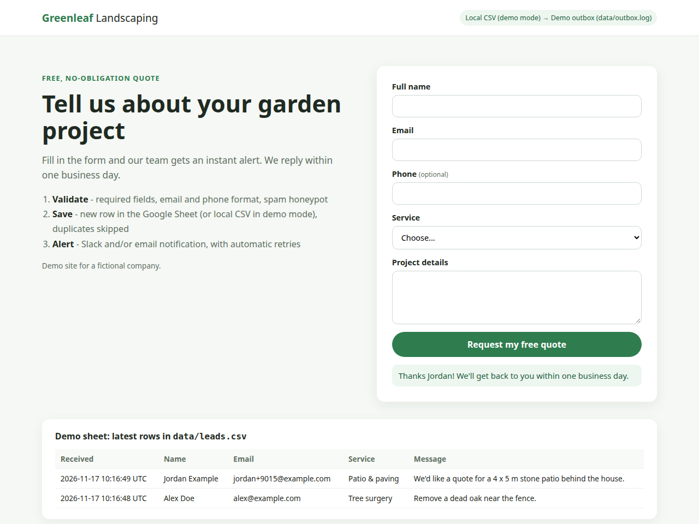

# Lead Form → Google Sheets → Email/Slack Alert

**Every website enquiry lands in a Google Sheet and pings your team on Slack or email within seconds - validated, de-duplicated and retried if a service hiccups.**



*Screenshot: a "request a quote" page for a fictional landscaping company in demo mode. After submitting, the visitor sees a confirmation and the new row appears in the demo sheet (a local CSV).*

Two implementations of the same flow are included:

1. **Python app** (`app/`) - a small web server with the form, validation, sheet connector and notifications.
2. **n8n workflow** (`n8n/`) - the same flow as an importable n8n workflow, for clients who prefer a no-code tool they can edit themselves.

## Features

- **Validation** - required fields, email and phone formats, allowed services, length limits, control-character stripping, and a hidden honeypot field against simple spam bots.
- **Google Sheets** - rows are appended through a Google **Apps Script Web App** (`apps_script/Code.gs`) protected by a shared secret. No Google Cloud project or service-account key needed.
- **Duplicate detection by email** - case-insensitive, done inside the sheet script under a lock (and in the CSV in demo mode).
- **Notifications** - Slack incoming webhook and/or SMTP email; both can be active at once.
- **Retries with backoff** - sheet and alert calls are retried (1 s, 2 s, 4 s). Errors that retrying cannot fix (wrong secret, Slack 4xx) fail fast.
- **No lost leads** - the lead is saved before alerts are sent; a failed alert is logged and returned as a warning.
- **Formula-injection guard** - values starting with `=`, `+`, `-` or `@` are stored as text.
- **Demo mode** - with no configuration, leads go to `data/leads.csv` and alerts are written to `data/outbox.log` (see `docs/sample-outbox.log`).

## Quick start (demo mode, one command)

Requirements: Python 3.10+ and `requests`.

```bash
python -m app.server
```

Open http://127.0.0.1:8001 and submit the form, or open http://127.0.0.1:8001/?autoplay to fill and submit a sample request automatically.

Or use the API directly:

```bash
curl -X POST http://127.0.0.1:8001/api/leads -H 'Content-Type: application/json' \
  -d '{"name":"Sam Rivera","email":"sam@example.com","service":"Lawn care","message":"Fortnightly mowing please"}'
```

Run the tests (they include a fake Apps Script endpoint to test retries and duplicates):

```bash
python -m unittest discover tests
```

## Connecting the real services

1. **Google Sheet** - create a sheet, open *Extensions → Apps Script*, paste `apps_script/Code.gs`, add a script property `SHARED_SECRET`, and deploy as a Web App (*Execute as: Me*, *Who has access: Anyone*). Put the Web App URL and secret in `.env`.
2. **Slack** - create an incoming webhook for your channel and set `SLACK_WEBHOOK_URL`.
3. **Email** - set the `SMTP_*` and `ALERT_EMAIL_*` variables (e.g. a Google Workspace or Microsoft 365 mailbox with an app password, or a transactional email service).

```bash
cp .env.example .env   # fill in the values
python -m app.server
```

Why Apps Script instead of the Sheets API? The Sheets API needs a service-account key signed with RS256, which requires extra crypto packages and a Google Cloud project. The Apps Script route needs neither and the client keeps the script in their own account. Switching to the official API is a drop-in replacement of `AppsScriptSheet` if a client prefers it.

## n8n version

`n8n/lead-to-sheet-alert.workflow.json` can be imported via *Workflows → Import from File*. Flow:

```
Webhook (POST /new-lead) → Validate lead (Code) → Is valid?
   ├─ no  → Respond 400 with field errors
   └─ yes → Find existing email (Google Sheets) → Already in sheet?
              ├─ yes → Respond 200 (duplicate)
              └─ no  → Append lead to sheet → Slack alert → Respond 201
```

After import, select your Google Sheets and Slack credentials, set the spreadsheet ID (placeholder `REPLACE_WITH_YOUR_SPREADSHEET_ID`) and make sure the sheet named `Leads` has the header row `Received, Name, Email, Phone, Service, Message`. The sheet and Slack nodes retry 3 times; a Slack failure does not block the response. The JSON is generated by `n8n/build_workflow.py`, so it is easy to regenerate after changes. It was written by hand to the n8n export format and checked for valid structure and JavaScript, but not run inside an n8n instance as part of this demo.

## Adapting it for a client

- Change the form fields and the `SERVICES` list in `app/validation.py` (and the matching columns in `Code.gs`).
- Point an existing website form (WordPress, Webflow, Wix, plain HTML) at `POST /api/leads` instead of using the sample page.
- Add routing: different Slack channels per service, or an email to the right sales person.
- Add a CRM step (HubSpot, Pipedrive) or an auto-reply email to the lead.
- Deploy on a small VPS or container platform behind HTTPS, or run the n8n version on n8n Cloud.

## File tree

```
lead-to-sheet-alert/
├── app/
│   ├── server.py        # stdlib HTTP server: form page + JSON API
│   ├── pipeline.py      # validate -> save -> notify
│   ├── validation.py    # field rules, honeypot, normalisation
│   ├── sheets.py        # Apps Script Google Sheet connector + CSV fallback
│   ├── notify.py        # Slack webhook, SMTP email, demo outbox
│   ├── retry.py         # retry with exponential backoff
│   └── config.py        # settings from environment / .env
├── apps_script/Code.gs  # Google Sheets web app (append + duplicate check)
├── n8n/
│   ├── lead-to-sheet-alert.workflow.json   # importable n8n workflow
│   └── build_workflow.py                   # generates the JSON
├── static/              # sample landing page, form CSS and JS
├── tests/test_pipeline.py
├── data/                # demo CSV and outbox (created at runtime, git-ignored)
├── docs/                # screenshot.png, sample-outbox.log
├── .env.example
└── requirements.txt
```
